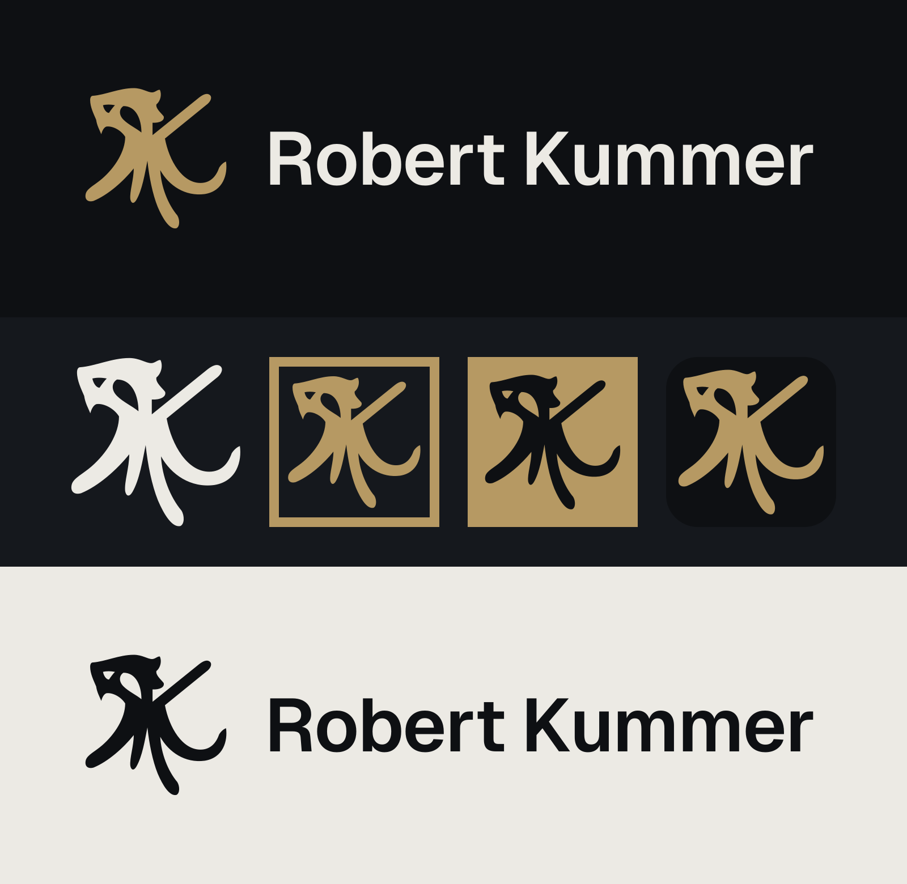

# Robert Kummer – Media Kit

Logos, Icons, Farben und Typografie für Robert Kummer IT. Basis ist der Website-Entwurf „Variante C“ für robert-kummer.de.



## Inhalt

```
logo/
├── mark/       Bildmarke RK, quadratisch, ohne Rahmen  ← Master
├── badge/      Bildmarke im quadratischen Rahmen
├── lockup/     Bildmarke + „Robert Kummer“ (horizontal)
├── wordmark/   Punkt + „Robert Kummer“ (wie im Website-Header)
└── legacy/     ursprüngliche Dateien (Gold, mit Rahmen) – nicht mehr verwenden
icon/           Avatare, Favicon (svg/ico), App-Icons, apple-touch-icon
png/            Rasterexporte der Logos (256/512/1024 px)
tokens.json     Farben, Fonts, Radien als Design Tokens
colors.md       Farbpalette mit Regeln
typography.md   Schriften
```

## Varianten

Jedes Logo gibt es in vier Ausführungen:

| Suffix | Farbe | Einsatz |
|---|---|---|
| *(ohne)* | `currentColor` | Inline-SVG in HTML/Vue, Farbe kommt aus CSS |
| `-light` | `#ECEAE4` (Lockup/Wortmarke mit Akzent `#B69963`) | auf dunklem Grund |
| `-dark` | `#0E1013` | auf hellem Grund |
| `-accent` | `#B69963` | Bildmarke als Akzent auf `#0E1013` |

**Faustregel:** Für Web immer die SVGs verwenden. PNGs nur, wo SVG nicht geht (Social-Profile, Office, E-Mail-Signatur).

## Einsatz

| Wo | Datei |
|---|---|
| Website-Header | `logo/wordmark/rk-wordmark-light.svg` oder `logo/lockup/rk-lockup-light.svg` |
| Favicon | `icon/favicon.svg` + `icon/favicon.ico` + `icon/png/apple-touch-icon.png` |
| GitHub-, LinkedIn-, Social-Avatar | `icon/png/rk-avatar-dark-1024.png` (oder `-accent`) |
| Präsentationen, Dokumente | `png/rk-lockup-dark.png` / `-light.png` |
| Stempel, Siegel, kleine Flächen | `logo/badge/` |

```html
<link rel="icon" href="/favicon.ico" sizes="any">
<link rel="icon" href="/favicon.svg" type="image/svg+xml">
<link rel="apple-touch-icon" href="/apple-touch-icon.png">
```

## Regeln

- **Schutzzone:** rund um das Logo mindestens ¼ der Markenhöhe frei lassen.
- **Mindestgröße:** Bildmarke 16 px (Favicon), Lockup 120 px breit.
- Nicht verzerren, drehen, mit Effekten (Schatten, Verlauf, Kontur) versehen oder umfärben außerhalb der Palette.
- Die Bildmarke steht auf ruhigem Grund. Auf Fotos nur mit ausreichendem Kontrast.
- Akzent `#B69963` sparsam einsetzen (siehe [colors.md](colors.md)).

## Rechte

Logo, Bildmarke und Wortmarke: © Robert Kummer. Alle Rechte vorbehalten. Nutzung für Berichte über Robert Kummer IT und für Verlinkungen ist erlaubt, wenn die Datei unverändert bleibt.

Die Schriften Geist und Geist Mono stehen unter der SIL Open Font License 1.1 (© Vercel).

Kontakt: post@robert-kummer.de
